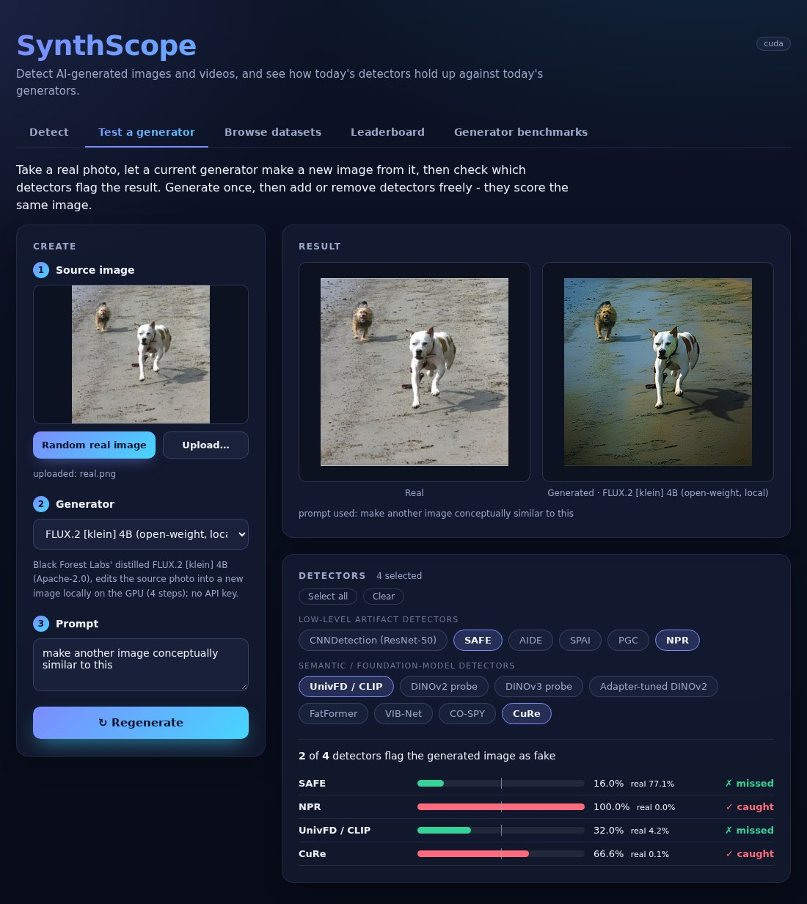
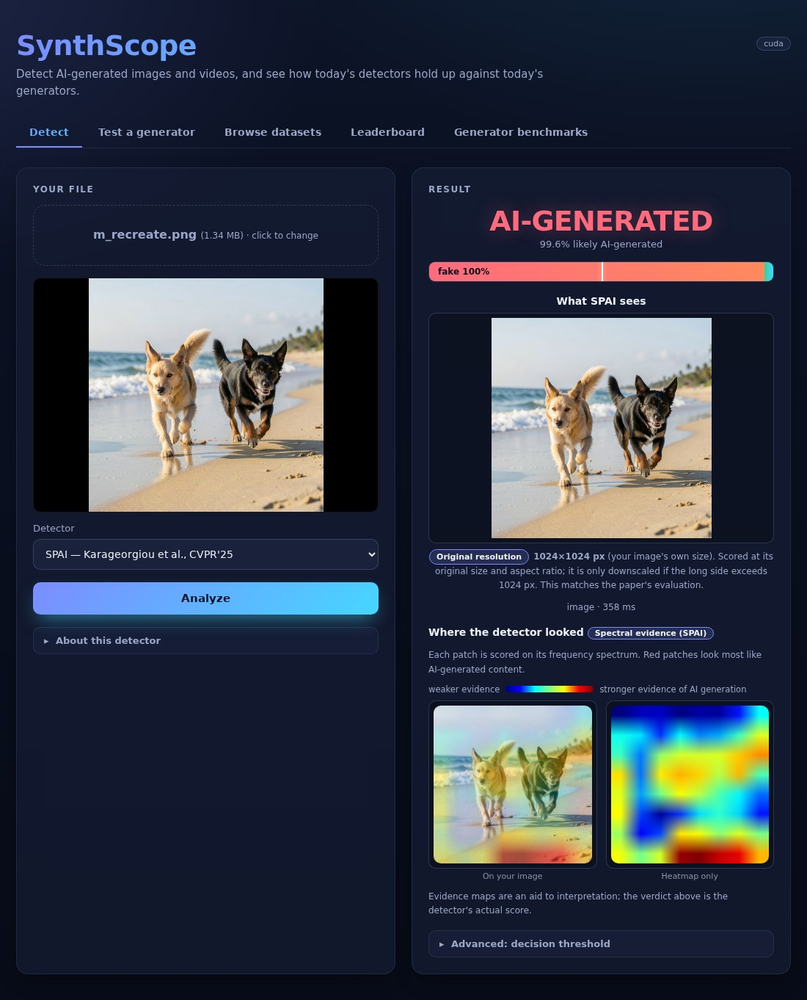
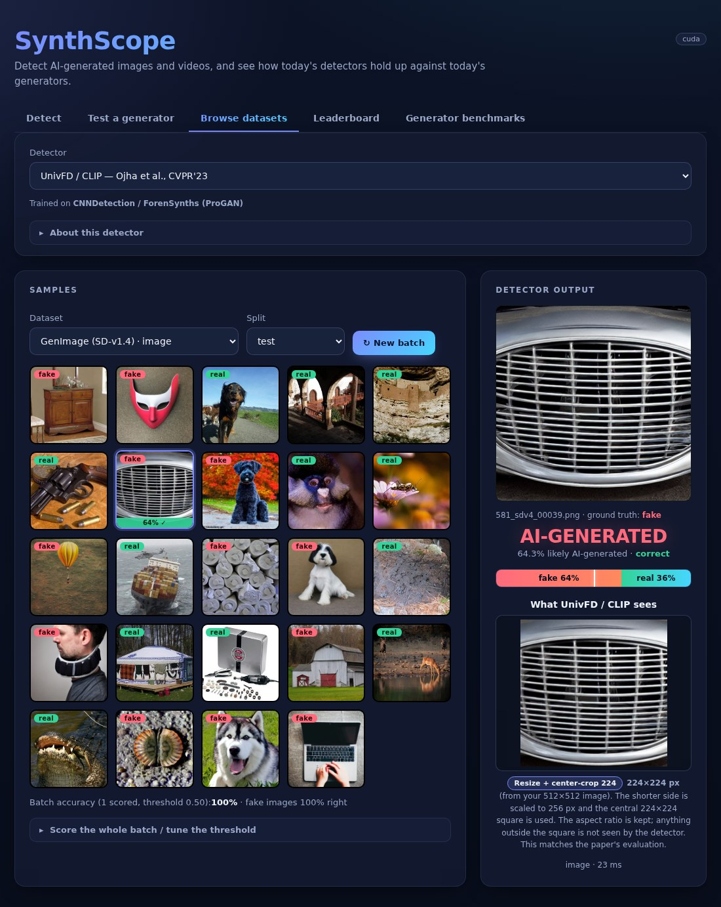
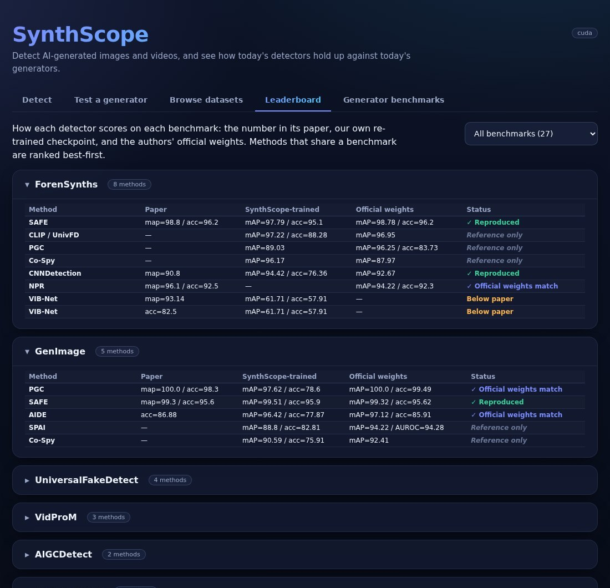
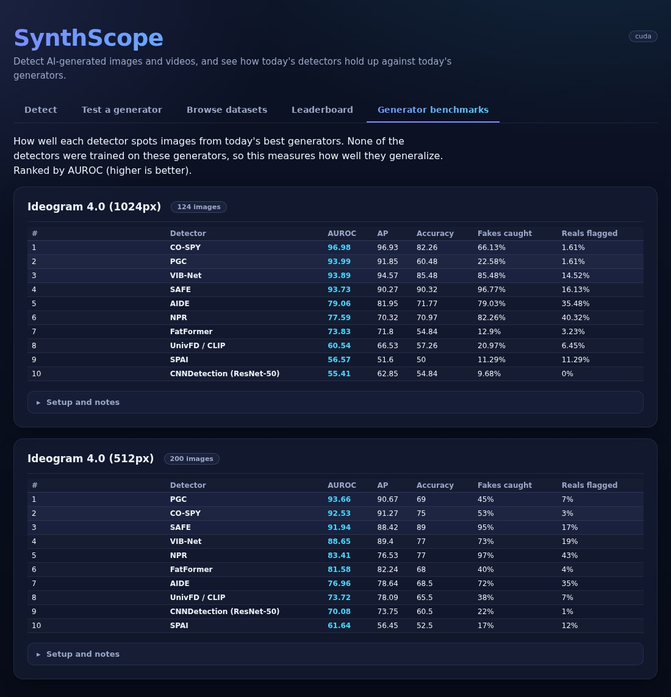

# SynthScope — AI-Generated Image & Video Detection

[](LICENSE)
[](pyproject.toml)
[](https://github.com/SMSD75/SynthScope/actions/workflows/ci.yml)
[](CONTRIBUTING.md)

🔎 **Check whether an image or video is AI-generated, and see how well 14 published detectors (plus 3 DINO baselines) hold up against today's generators.**
Try it in the browser 🌐, call it from Python 🐍, or reproduce the papers' results 📊 — with the benchmark datasets **downloaded and organized for you**.

<p align="center">
  <a href="#-web-demo"><b>🌐 Web demo</b></a> ·
  <a href="#-install">📦 Install</a> ·
  <a href="#-python-and-command-line">🐍 Python &amp; CLI</a> ·
  <a href="#-detectors">🔍 Detectors</a> ·
  <a href="#-benchmarks">📊 Benchmarks</a> ·
  <a href="#-train-your-own">🏋️ Train</a> ·
  <a href="#-whats-trending">📈 Trending</a> ·
  <a href="#-contributing-and-license">🤝 Contributing</a>
</p>

---

## 🌐 Web demo

A browser app for trying the detectors without writing code. The detectors always run on your own machine.

| Tab | What you do there |
| --- | --- |
| **Detect** | Upload an image or video, pick a detector, and get a verdict with a probability. The page shows the image *as the detector sees it* (after that detector's own preprocessing, with a short explanation) and, for some detectors, a heatmap of where it looked. |
| **Test a generator** | Take a real photo and let a current image generator make a new image from it: either **re-create** it from a written description of your photo (every pixel is synthesized) or **edit** your photo. Then see which detectors catch the result. Generate once, then add or remove detectors freely: they all score the same image. A similarity score warns you when a result is just a lightly edited copy of your photo. |
| **Browse datasets** | Click through samples of the benchmark datasets and see a detector's score on each. Score a whole batch and tune the decision threshold. |
| **Leaderboard** | Every method on every benchmark it reports: the paper's number, our own retrained checkpoint, and the authors' official weights. |
| **Generator benchmarks** | How each detector does against specific modern generators, ranked by AUROC. |

<p align="center">
  
  
</p>
<p align="center"><sub><b>Left:</b> <i>Test a generator</i>, where your photo is described in words, FLUX.2 klein creates a new image from that description, and four detectors score both.
<b>Right:</b> <i>Detect</i>, with the verdict, the image as the detector sees it, and a heatmap.</sub></p>

<details>
<summary><b>More screenshots</b>: Browse datasets, Leaderboard, Generator benchmarks</summary>





</details>

### 🔌 Connect your own generators

The *Test a generator* tab creates the AI-generated images that the detectors are tested on, and you choose which generator makes them.
Hosted services (Nano Banana, GPT Image, Grok, FLUX.1) work once you add your own API key; the open-weight models run on your own GPU and need no key.

To add a key, copy `.env.example` to `.env`, paste the keys you have, and restart the page. A generator without a key is greyed out in the
dropdown, so you only need the ones you want to use.

| Generator | How to connect | Modes |
| --- | --- | --- |
| **Nano Banana** (Gemini 2.5 Flash Image) | `GEMINI_API_KEY` ([get a key](https://aistudio.google.com/apikey)) | re-create, edit |
| **GPT Image** (`gpt-image-1`) | `OPENAI_API_KEY` ([get a key](https://platform.openai.com/api-keys)) | re-create, edit |
| **Grok** (`grok-2-image`) | `XAI_API_KEY` ([get a key](https://console.x.ai)) | re-create |
| **FLUX.1** (via fal.ai) | `FAL_KEY` ([get a key](https://fal.ai/dashboard/keys)) | re-create, edit |
| **Open-weight, runs locally** (no API key): Ideogram 4.0, FLUX.2 [klein] 4B and 9B, FLUX.1 Kontext, Qwen-Image-2.1 | a 24 GB GPU, plus `HF_TOKEN` once to download gated weights; setup in [interface/README.md](interface/README.md) | re-create, edit (Kontext: edit only; Ideogram: re-create only) |

Hosted generators send your source photo or its description to that provider. The local models keep everything on your machine.
Missing your favorite generator? Adding one takes a small function and one registry entry in
[`interface/backend/generators.py`](interface/backend/generators.py).

**🚀 Run it**

```bash
pip install -e ".[web]"                            # or: pip install -r interface/requirements.txt
export SYNTHSCOPE_CKPT_DIR=/path/to/checkpoints    # one <detector key>.pth per detector (see below)
bash interface/run_backend.sh                      # serves http://localhost:8000
```

Each detector needs its weights as `<key>.pth` in `SYNTHSCOPE_CKPT_DIR` (for example `cure.pth`, `npr.pth`); every model's
`README.md` under [models/](models/) says where the authors publish theirs. Detectors without weights are greyed out on the page,
and the training-free ones (D3, STALL) need none. Setup details and the local-generator setup are in
[interface/README.md](interface/README.md).
Prefer something lighter? The [Colab quickstart](notebooks/synthscope_quickstart.ipynb) installs SynthScope, downloads the
official CuRe weights and checks an image of yours in a few cells. There is also a small [Gradio demo](demo/)
(`pip install -e ".[demo]" && python demo/app.py`).

---

## 📦 Install

```bash
git clone https://github.com/SMSD75/SynthScope.git
cd SynthScope
pip install -e .                 # editable install
# extras:  ".[web]" web demo · ".[train]" wandb + dataset download · ".[dev]" contributor tooling
```

Install the [PyTorch](https://pytorch.org) build that matches your CUDA. A couple of detectors
(`clip`, `fat_former`) also need OpenAI CLIP: `pip install git+https://github.com/openai/CLIP.git`.
See [LICENSES.md](LICENSES.md) for per-method/weight licenses.

## 🐍 Python and command line

Run any detector on an image or video and get the probability it is AI-generated:

```python
import synthscope

synthscope.list_models()                         # detectors + which weights are present
det = synthscope.load("fat_former")              # builds lazily; downloads backbones on first use
det.predict("photo.png")
# -> {'model': 'fat_former', 'fake_probability': 0.98, 'verdict': 'fake', 'confidence': 0.98, ...}

det.predict("clip.mp4")                    # image detectors sample frames; video detectors score the clip
synthscope.load("d3").predict("clip.mp4")        # D3 is training-free — no checkpoint needed
```

From the shell:

```bash
synthscope list                                  # list detectors and weight availability
synthscope detect photo.png --model fat_former   # human-readable verdict
synthscope detect clip.mp4  --model d3 --json    # machine-readable
```

Weights are read from `$SYNTHSCOPE_CKPT_DIR/<key>.pth` (default `~/.cache/synthscope/checkpoints`); pass
`synthscope.load(..., checkpoint="/path/to.pth")` to use your own weights. Training-free detectors
(D3, STALL) need none.

### 🤗 Model zoo (Hugging Face Hub)

`synthscope.load(...)` can fetch missing weights from a Hugging Face model-zoo repo (`SYNTHSCOPE_HUB_REPO`, or
`synthscope.load(..., repo="user/synthscope-checkpoints")`). **The public SynthScope zoo is not published yet**, so for now put the
weights in `SYNTHSCOPE_CKPT_DIR` yourself (each model's README links the official download), or host your own zoo:

```bash
synthscope pull --model clip                                 # fetch one checkpoint
synthscope push --repo user/synthscope-checkpoints --public        # publish SynthScope-trained checkpoints (license-safe)
```

`push` uploads only SynthScope-trained checkpoints by default; weights derived from authors' official
releases are held back unless you opt in and confirm the upstream license permits redistribution.

---

## 🔍 Detectors

Select a detector with `model@ModelConfig=image/<name>` (image) or `model@ModelConfig=video/<name>`. Most
methods freeze a large pretrained backbone and train a lightweight head/adapter; see each model's
`README.md` under [models/](models/) for details.

### 🖼️ Image detectors

| `model_type` | Method | Idea |
| --- | --- | --- |
| `clip` | **UnivFD / CLIP** (Ojha, CVPR'23) | Linear probe on frozen CLIP ViT-L/14 features. |
| `cnn` | **CNNDetection** (Wang, CVPR'20) | ImageNet ResNet-50 fine-tuned as real/fake. |
| `npr` | **NPR** (Tan, CVPR'24) | Small ResNet on neighboring-pixel residuals (up-sampling artifacts). |
| `fat_former` | **FatFormer** (Liu, CVPR'24) | Frozen CLIP + forgery-aware adapters + learnable text prompts. |
| `aide` | **AIDE** (Yan, ICLR'25) | ConvNeXt semantic features fused with low-level DCT/SRM cues (native-res 5-view). |
| `safe` | **SAFE** (Li, KDD'25) | Lightweight DWT high-frequency artifact detector + targeted augmentation. |
| `co_spy` | **Co-Spy** (Cheng, CVPR'25) | Adaptive fusion of a SigLIP semantic stream and an SD-VAE artifact stream. |
| `spai` | **SPAI** (Karageorgiou, CVPR'25) | Spectral reconstruction-similarity + context attention, any-resolution. |
| `vib_net` | **VIB-Net** (Zhang, CVPR'25) | Variational information bottleneck on frozen CLIP features. |
| `pgc` | **PGC** (Zhou, 2026) | LoRA-tuned DINOv2 + YCbCr-residual CNN, peak-guided calibration. |
| `cure` | **CuRe** (manic-cui, 2026) | Frozen Perception-Encoder Core L/14 + Q/V LoRA + source-response subspace, trained by regressing real↔generated mixing ratios on SD‑v1.4 only (official adapter). |
| `dinov2` / `dinov3` / `adapted_dino` | DINO probes | DINOv2/v3 backbone + linear head (or per-block adapters). |

### 🎬 Video detectors

| `model_type` | Method | Idea |
| --- | --- | --- |
| `d3` | **D3** (Zheng, ICCV'25) | Training-free: second-order dynamics of frozen X-CLIP frame features (disentangled detail dynamics). |
| `restrav` | **ReStraV** (Internò, 2025) | Geometry of the frame-embedding trajectory in a frozen DINOv2 space, scored by a small MLP. |
| `stall` | **STALL** (Ben Hayun, CVPR'26) | Training-free: spatio-temporal whitened log-likelihoods under real-video statistics (DINOv3). |

Image detectors can also score a video: they run frame by frame and average the result.

---

## 📊 Benchmarks

> **Setting up the benchmarks?** The [benchmark guide](docs/BENCHMARKS.md) explains the three kinds of benchmark below, where to
> get each dataset (with a download helper), the exact commands, run times, and how results show up in the web page.

| Benchmark | Question it answers | Run | Shown in |
| --- | --- | --- | --- |
| **Paper reproduction** | Does our port match the published numbers? | `benchmark/bench_eval.py` | Leaderboard tab |
| **Generator benchmark** | How do detectors do against a given image generator (FLUX, Qwen, ...)? | `benchmark/generator_bench.py` | Generator benchmarks tab |
| **Standardized submissions** | A versioned, comparable table anyone can submit to | `benchmark/evaluate.py` | [LEADERBOARD.md](LEADERBOARD.md) |

### 📥 Datasets download and organize themselves

You don't hunt for benchmark data or rearrange folders. Every supported dataset has a config that records its official source,
and its built-in loader **downloads it, unpacks it safely and restructures it into one common layout**
(`<generator>/{0_real,1_fake}/…`) that every tool in SynthScope reads: the evaluators, the training loop and the web page's
*Browse datasets* tab.

```bash
python benchmark/download_dataset.py --list                                          # all supported datasets and where they come from
python benchmark/bench_eval.py --model npr --dataset commgen15 --root /data/CommGen15   # download if missing, then evaluate
python benchmark/download_dataset.py commgen15 --root /data/CommGen15                  # or only download + lay out
```

`bench_eval.py --dataset` does it all in one step: it downloads the dataset if it isn't on disk, finds the folder to evaluate and
the right grouping profile on its own, and prints per-generator results. Run it again and it reuses what is already there.

Training does the same on its own: a dataset config with `prefetch: true` fetches its data the first time you use it
(`DatasetConfig.root_dir=...` chooses where). Some sets are large (for example AIGIBench is about 220 GB), so check your disk
first. Full details: [benchmark guide](docs/BENCHMARKS.md#2-datasets-for-the-paper-benchmarks).

**Supported benchmark datasets** — 13 image and 8 video. *Auto* means the loader downloads and arranges it.

| Dataset (`config name`) | What it is | Source | Download |
| --- | --- | --- | --- |
| `cnndetection` | ForenSynths: ProGAN training set, GAN test sets | Google Drive | Auto |
| `universialfakedetection` | UnivFD test sets (LDM, Glide, DALL·E, guided) | Google Drive | Auto |
| `genimage`, `genimage_full` | GenImage: SD-v1.4 training set, 8 generators | Hugging Face | Auto |
| `aigibench` | AIGIBench | Hugging Face | Auto |
| `aigcdetect` | AIGCDetectBenchmark, 16 generators | ModelScope | Auto |
| `cospy` | Co-Spy-Bench | Hugging Face | Auto |
| `synthbuster` | Synthbuster | Zenodo | Auto |
| `ditfake`, `commgen15` | DiTFake, CommGen15 (commercial generators) | Hugging Face | Auto |
| `diffusionforensics`, `diffusion1kstep` | DiffusionForensics, Diffusion-1kStep | Google Drive | Auto |
| `freqnetdetection` | FreqNet GAN set | Google Drive | Auto |
| `evalcrafter`, `genvidbench`, `videofeedback`, `comgenvid` | video benchmarks | Hugging Face | Auto |
| `genvideo`, `vidprom`, `videophy`, `physics_iq` | video benchmarks | official sites | Place by hand in the same layout |

The **Leaderboard** tab covers 30+ benchmark groups across these datasets.

### 🏁 Standardized leaderboard

[LEADERBOARD.md](LEADERBOARD.md) is a smaller, **versioned** table with a fixed protocol per track (fixed test set, per-generator
metrics, one evaluation pipeline), so anyone can submit a comparable number. It currently has 3 tracks (ForenSynths, GenImage
SD-v1.4, GenVideo-Val) and grows as protocols are fixed; the protocol is in [benchmark/](benchmark/).

```bash
python benchmark/evaluate.py --model fat_former --track forensynths --data <root> \
    --out benchmark/submissions/fat_former.json
python benchmark/leaderboard.py        # refresh the table
```

Submit your own result via PR — one JSON under [benchmark/submissions/](benchmark/submissions/); CI
validates it against the [schema](benchmark/schema.json).

### ✅ Does each detector match its paper?

Each published detector is checked against its own paper, through the same SynthScope pipeline. One headline benchmark per
detector is below; the Leaderboard tab and each model's `README.md` list every benchmark, and
[`repro/AGGREGATED_BENCHMARK.md`](repro/AGGREGATED_BENCHMARK.md) has the per-generator tables. *Official* means the authors'
released weights run through SynthScope; otherwise the number is from our own retrained checkpoint. Numbers are mAP unless noted.

| Detector | Headline benchmark | Paper | SynthScope | Status |
| --- | --- | ---: | ---: | --- |
| CLIP / UnivFD | UniversalFakeDetect | 95.0 | 96.44 | ✅ reproduced |
| CNNDetection | ForenSynths | 90.8 | 94.42 | ✅ reproduced |
| FatFormer | ForenSynths-8 | 99.7 | 99.70 (official) | ✅ official weights match |
| NPR | GANGen-Detection | 96.6 | 96.49 (official) | ✅ official weights match |
| AIDE | GenImage | 86.9 acc | 85.9 acc (official) | ✅ official weights match |
| SAFE | GenImage-8 | 99.3 | 99.51 | ✅ reproduced |
| Co-Spy | Co-Spy-Bench | 96.0 | 96.60 | ✅ reproduced |
| PGC | GenImage | 100 | 100 (official) | ✅ official weights match |
| CuRe | AIGIBench (20 subsets) | 92.8 acc | 92.85 acc (official) | ✅ official weights match |
| STALL (video) | GenVideo-Val | 80 AUROC | 83.5 AUROC | ✅ reproduced |
| ReStraV (video) | GenVidBench | 93.0 avg. acc | 92.7 mAP / 86.9 acc | ⚠️ different metric; accuracy is lower |
| D3 (video) | GenVideo-Val | 98.5 | 95.95 AUROC | ⚠️ mAP not comparable: our test pool is far more imbalanced |
| SPAI | GenImage | not reported | 94.22 (official) | ⚠️ the paper's own test set is not in SynthScope yet |
| VIB-Net | GenImage SD-v1.4 | 95.5 | 83.94 | ❌ below the paper (no official weights to compare) |

---

## 🏋️ Train your own

Compose three Hydra config groups and override any field with dot-paths:

```bash
accelerate launch --config_file accelerate_config.yaml --num_processes 2 main.py \
  trainer@TrainerConfig=image/aide model@ModelConfig=image/aide dataset@DatasetConfig=image/genimage \
  DatasetConfig.train_batch_size=16 logger.name=aide
```

Or use a method's ready-made recipe in [experiments/](experiments/) (e.g. `bash experiments/image/aide.sh`).
Datasets (`dataset@DatasetConfig=<name>`) auto-download to their `root_dir` and restructure into the
common `<generator>/{0_real,1_fake}` layout; transforms are named pipelines in [transformations.py](transformations.py).
Training interleaves validation/test each epoch and logs per-generator metrics to Weights & Biases.
See [CONTRIBUTING.md](CONTRIBUTING.md) and [docs/ADD_DETECTOR.md](docs/ADD_DETECTOR.md) to add a detector.

---

<!-- TRENDING:START -->
## 📈 What's Trending

A curated, daily-refreshed list of recent image & video AIGC-detection papers with public code: **15 image · 6 video** tracked (13 already integrated in SynthScope), last updated **2026-10-10**. → **[TRENDING.md](TRENDING.md)**.
<!-- TRENDING:END -->

---

## 🤝 Contributing and license

Contributions are welcome: see [CONTRIBUTING.md](CONTRIBUTING.md) and [docs/ADD_DETECTOR.md](docs/ADD_DETECTOR.md) for how to add a
detector, and submit benchmark results through a pull request. SynthScope is released under the [Apache 2.0 license](LICENSE);
the third-party detectors, weights and datasets it loads keep their own licenses ([LICENSES.md](LICENSES.md)). To cite it, use
[CITATION.cff](CITATION.cff).
